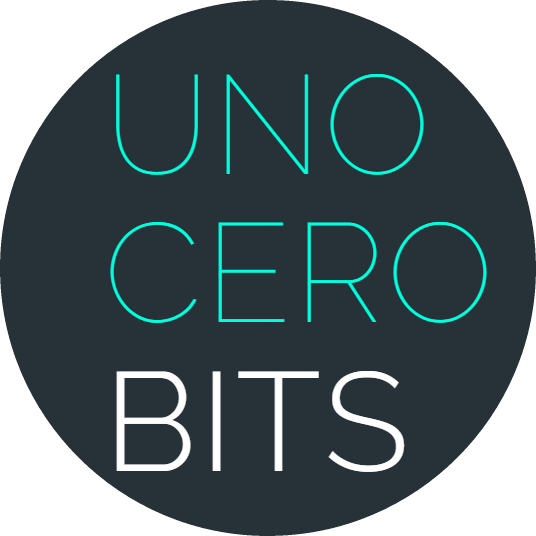

# T lo traigo

 &nbsp; 

App Android para que las personas mayores de los pueblos de León (o sus familiares) pidan la compra del supermercado y un vecino repartidor se la lleve a casa.

Desarrollada por **Xito Development** (xito@unocerobits.com) y **UNOCEROBITS** (info@unocerobits.com) · Soporte: tlotraigo@unocerobits.com · · Repositorio: [Xito-Development/T-lo-traigo](https://github.com/Xito-Development/T-lo-traigo) · info@unocerobits.com · [unocerobits.com](https://tlotraigo.unocerobits.com/)

## Stack
- **Android**: Kotlin 2.0, Jetpack Compose (Material 3), `minSdk` 21 (Android 5.0), `targetSdk` 36 (Android 16).
- **Backend**: Supabase (Auth, Postgres con RLS, RPC, Storage, pg_cron). Región UE (París).
- **CI/CD**: GitHub Actions → al subir una versión nueva en `version.properties` crea tag y Release (APK + AAB) con notas del `CHANGELOG.md`; subida opcional a Google Play.

## Funcionalidad
| Rol | Qué hace |
|---|---|
| Cliente | Catálogo, cesta persistente, entrega lo antes posible o programada, pago (efectivo/Bizum/tarjeta simulados), seguimiento, valoraciones, pedir para un familiar |
| Repartidor | Candidatura, disponibilidad, pueblos y cobros aceptados, aceptar/rechazar pedidos, lista con casillas, ganancias y penalizaciones |
| Admin | Productos (iconos o foto, IVA 4/10/21 %), tarifas, pueblos, opiniones |
| Superadmin | Todo lo anterior + roles, autorización de repartidores y candidaturas |

Tarifas (calculadas en servidor, `_order_quote`): servicio % con mínimo + por unidad extra + envío base del pueblo + km × tarifa + suplemento en el día. Penalización a repartidores si un pedido de sus pueblos supera 48 h sin aceptar (cron horario) o si lo rechazan pasado ese tiempo.

## Accesibilidad
Modo fácil, 4 tamaños de letra, lectura en voz alta, 7 paletas, modo claro/oscuro, alto contraste y 5 tipografías (Atkinson Hyperlegible por defecto).

## Publicar (Windows, un paso)
| Cuándo | Qué hacer |
|---|---|
| Solo la primera vez | Doble clic en **`configurar-firma.bat`**: crea la clave de firma y la guarda en GitHub. Copia la carpeta `%USERPROFILE%\TLoTraigo-firma` a un lugar seguro. |
| Cada versión nueva | Doble clic en **`publicar.bat`** y escribe en una frase qué ha cambiado. |

`publicar.bat` instala Git y GitHub CLI si faltan, inicia sesión, sube la versión (`0.4.0 → 0.4.1`), añade la entrada al `CHANGELOG.md` y hace push.
GitHub Actions compila y publica la Release con APK y AAB en unos 8 minutos: <https://github.com/Xito-Development/T-lo-traigo/releases/latest>.
Opciones: `publicar.bat -Tipo menor` (0.4 → 0.5), `-Tipo mayor` (→ 1.0.0) o `-SoloSubir` (sin versión nueva). En macOS/Linux: `scripts/publicar.sh`.

Actualizar desde Claude sin copiar a mano: doble clic **una vez** en **`instalar-vigilante.bat`** y elige la carpeta del proyecto. Desde entonces, cada `tlotraigo*.zip` que descargues **reemplaza** el proyecto (lo que no esté en el ZIP se elimina; se conservan `.git`, `local.properties` y las cachés de compilación), `web-t-lo-traigo*.zip` reemplaza `web\t-lo-traigo` y `CLAUDE.md` se copia en la raíz. Antes de cada reemplazo se guarda una copia en `%LOCALAPPDATA%\TLoTraigo\copias` (últimas 5). Para cambiar la carpeta: **`cambiar-ubicacion.bat`**.

Google Play (opcional): `configurar-firma.bat -PlayJson C:\ruta\cuenta-servicio.json` y cada versión se sube sola a pruebas internas.

## Puesta en marcha del backend
1. Supabase → Authentication: *Confirm email* activado, plantillas *Confirm signup* y *Reset password* con `{{ .Token }}`, SMTP propio.
2. Cuenta superadministrador: usuario `DNL-Owner` (correo `dnl-owner@tlotraigo.app`). Cambia la contraseña inicial.

Build local: `./gradlew assembleDebug` (JDK 17, Android SDK 36).

## Documentación
- [Publicación en Google Play](docs/PLAY_STORE.md) · [Llegar a iOS](docs/IOS.md) · [Sistema de diseño e icono](docs/DESIGN_SYSTEM.md)
- Web: `web/t-lo-traigo/` (landing `index.html` y `privacidad.html`) → subir a `tlotraigo.unocerobits.com/`
- Ficha de Play: `fastlane/metadata/android/es-ES/`
- [Changelog](CHANGELOG.md)

## Licencia
Software propietario. © 2026 UNOCEROBITS y Xito Development. Todos los derechos reservados. Ver [LICENSE](LICENSE) y [avisos de terceros](THIRD_PARTY_NOTICES.md).
